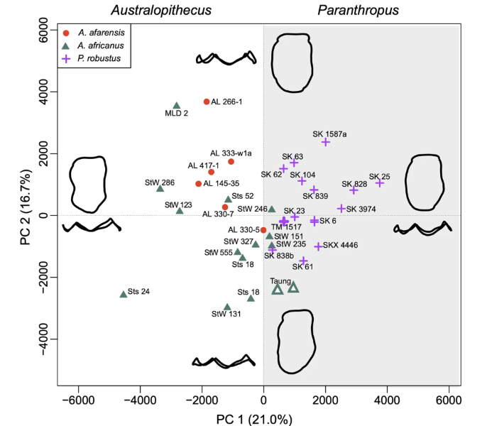

A century after the discovery of the Taung Child, the type specimen of *Australopithecus africanus* and the only indisputable representative of this species, the phylogenetic placement and species diversity of early southern African hominins remain unresolved. Addressing this longstanding ambiguity, an international team led by Gabriele Macho (AMGC-VUB) applied an eco-evolutionary framework that maps hominin dental and brain development against climatic and environmental shifts during the Plio-Pleistocene. The study is published in [*Nature Paleoecosystems*](https://doi.org/10.1038/s44513-026-00008-2).

The findings demonstrate that hydrological fluctuations around the Limpopo Valley, a pivotal biogeographic boundary separating the Zambezian and Natal/Kalahari zones and approximating the border between the tropics and the temperate zone, drove dynamic habitat shifts. As they tracked these shifting biomes, early hominin populations would have experienced recurring cycles of isolation, genetic drift, and hybridisation. This eco-evolutionary dynamic offers a compelling explanation for the extensive morphological variation that characterises southern African fossil assemblages.

<figure>
  
</figure>

[Read the full paper in *Nature Paleoecosystems*](https://doi.org/10.1038/s44513-026-00008-2){: .btn .btn--primary}